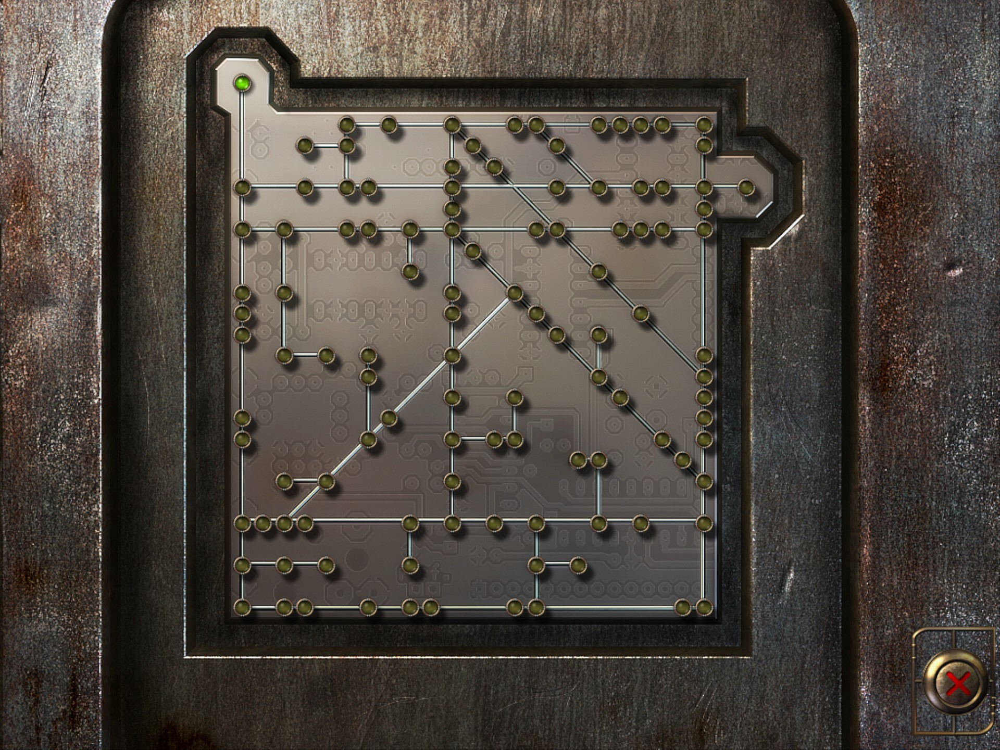

# Basement: Node Maze

[← Previous: Basement - Electrical Panel](../basement_knobs) | [Next: Basement - Water Pistons →](../basement_water)

## Solution

**Objective:** Find a path from the upper left node to the final node which sticks out on the right.

**Rules:** You can jump to nodes following connections in any direction, but only if that node is exactly 2 nodes away in that direction. In other words, you must always leap over exactly one node in the direction you choose.

```
D D D D
R UR UR D
D R D R
U U U UL
UL UL D R
R R
```


