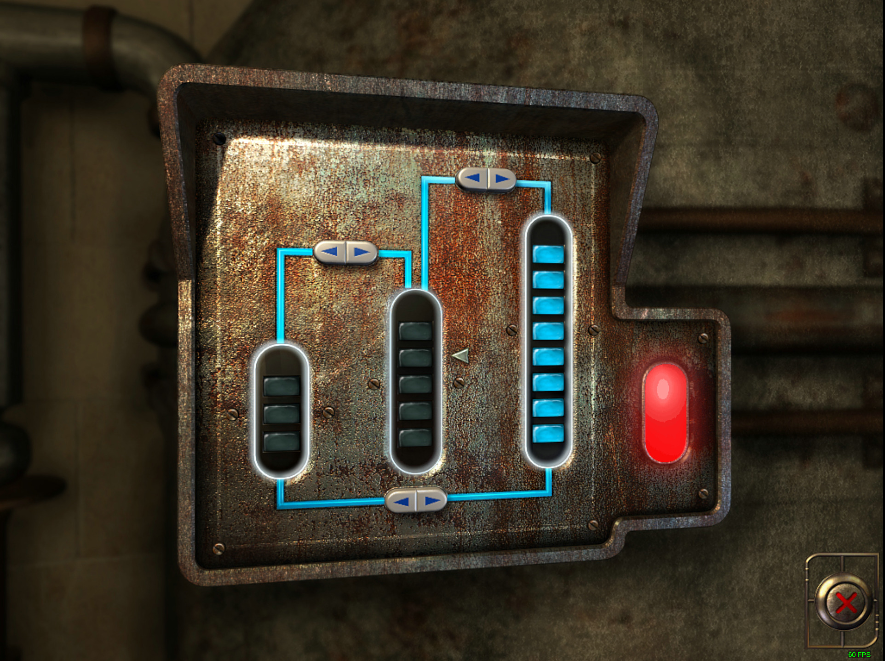

# Basement: Store Room

[← Previous: Basement - Node Maze](../basement_graph) | [Next: Kitchen - Dumbwaiter →](../kitchen_dumbwaiter)



## Solution

**Objective:** Fill the middle container with exactly 4 units of water.

**Rules:** Three containers hold capacities of 3 (Left), 5 (Middle), and 8 (Right) units. Right starts full. Water can be poured to and from any container, with excess staying in the source container.

**Solution:**
```
Right > Middle > Left > Right
Middle > Left
Right > Middle > Left
```
