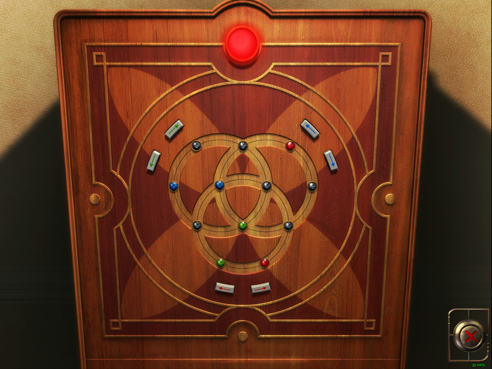

# Small Corridor: Concentric Circles

[Next: Museum - Dollar Safe →](../rotating_symbol_tiles)



## Solution

Three nested rings (red, green, blue) can each be rotated independently. Solve by getting each ring's colored arrow lined up with its matching beads. Rotate clockwise in this order:

```
Green  x2
Blue   x2
Red    x1
Green  x1
```
