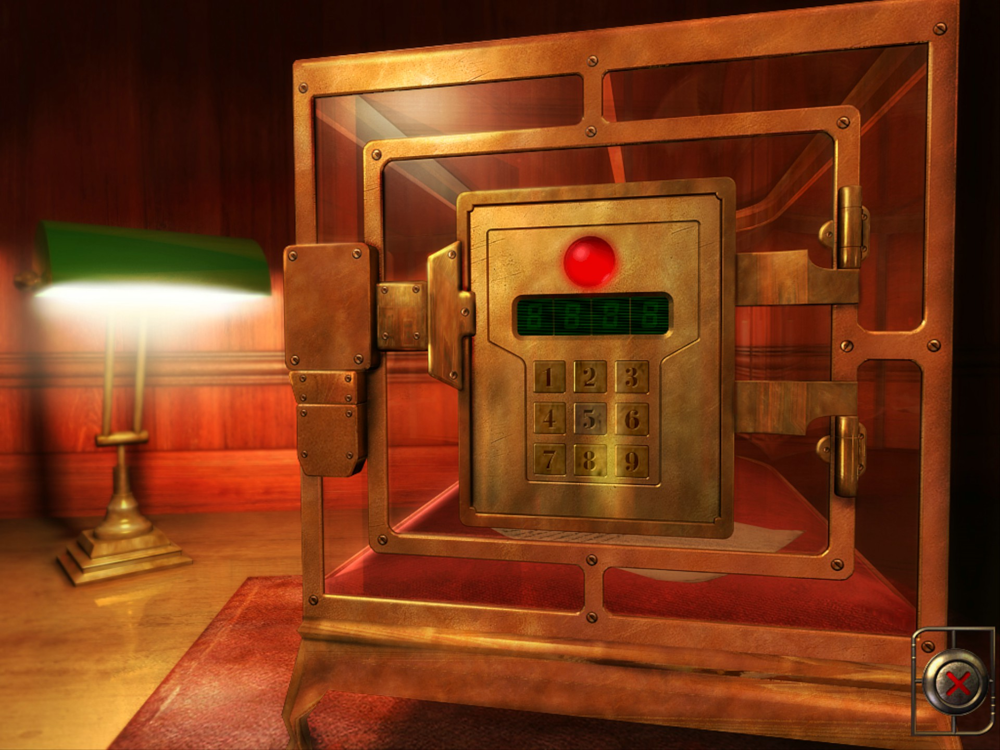
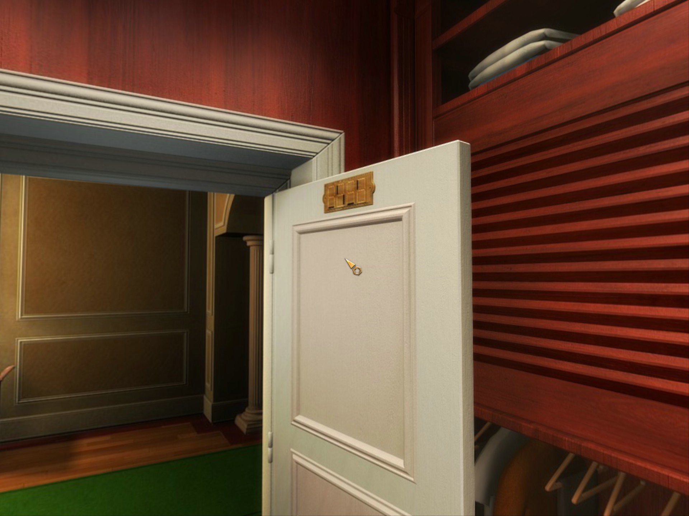
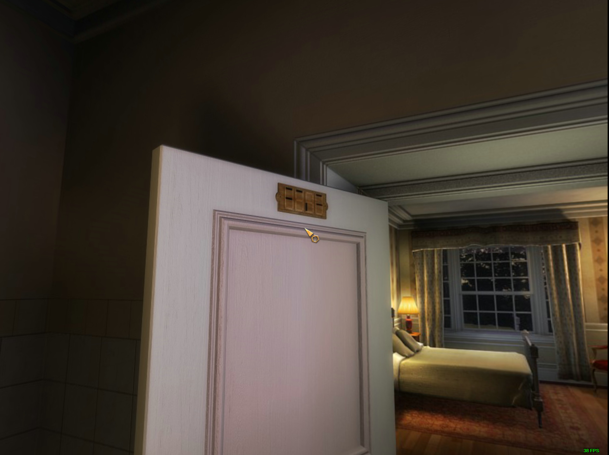

# Final Safe

[← Previous: Boudoir - Sliding Puzzle](../boudoir_slides)

## Solution

Four rooms (Violet, Yellow, Corridor, Dressing) each show the same 4 seven-segment digits, but with only some segments shown in each room. Overlaying (OR-ing) the lit segments from all four rooms for each digit position reconstructs the full digits:

**Solution:** `3528`
