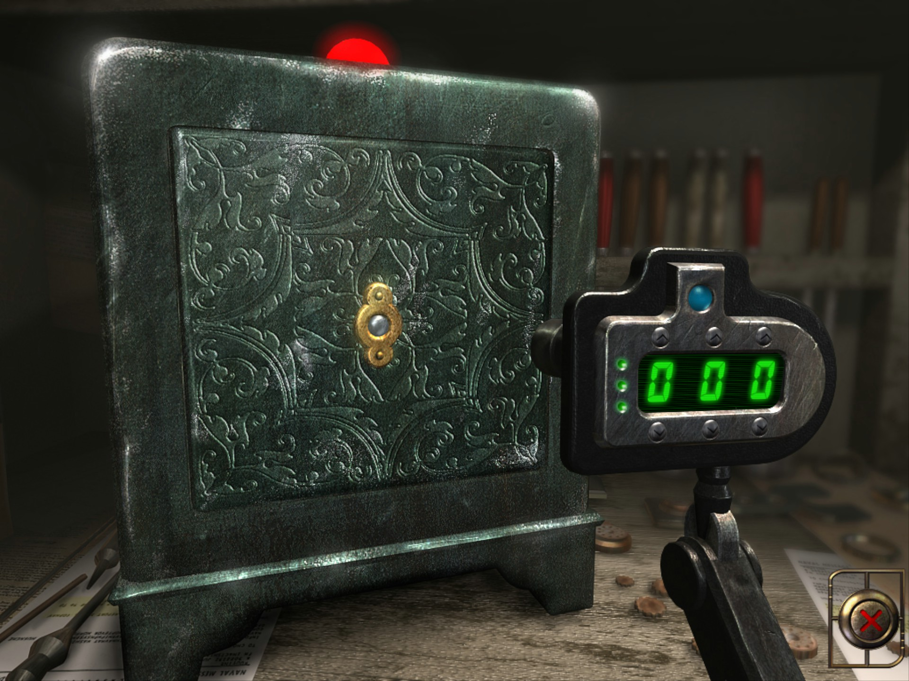

# Laser Safe

[← Previous: Workshop - Broken Keypad](../workshop_keypad) | [Next: Workshop - Dials →](../workshop_dials)

## Solution

Each colored laser panel corresponds to a wavelength range (violet, blue, green, yellow, orange, red). The code comes from the yellow range's upper bound minus 8.

**Solution:** `584` -- dial the three digits as 5 (turn up), 2 (turn down), 4 (turn up).

