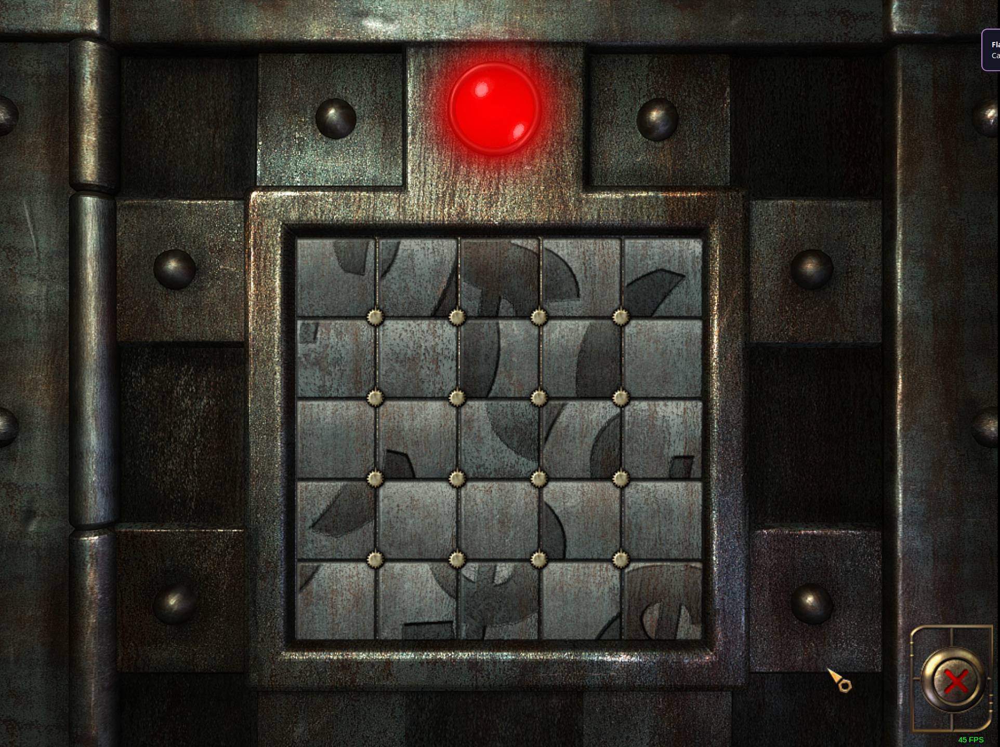

# Museum: Dollar Safe

[← Previous: Small Corridor - Red, Green, and Blue Circles](../rgb_rings) | [Next: Museum - Currency →](../museum_currency_sudoku)

## Solution

A 5x5 grid of tiles (corners missing, forming a plus shape) where clicking one of 16 intersection points rotates the surrounding 2x2 block of four tiles one quarter-turn clockwise. Each number below (0-15) is an intersection point -- row `n // 4`, column `n % 4` of the 4x4 grid of click points, counting from the top-left. Click them in this order (54 moves):

```
12 12 13 13  4  4  9  9 14 14 14  9 10 10 15
15 15 10  9  8  9  9 10  0  5  6  6 11  6 11
11  0  4  4  5  5  5  1  0  0  7  2  1  6  7
 7  3  3  2  1  1  7  6  3
```

**Note:** This is the best solution I could find, and may not be optimal.

An even better solution (46 moves), found via AI optimizations on the above approach (code not included in this repo):

```
 0  0  4  4  2  1 12 12 13 14 15 14 10  6  1
 0  0 15  3  3  2  1  1  7  6  6  2  3  7  6
11  6 10  9 14  9  9  5  5 14 13 14 13 12  9
13
```


