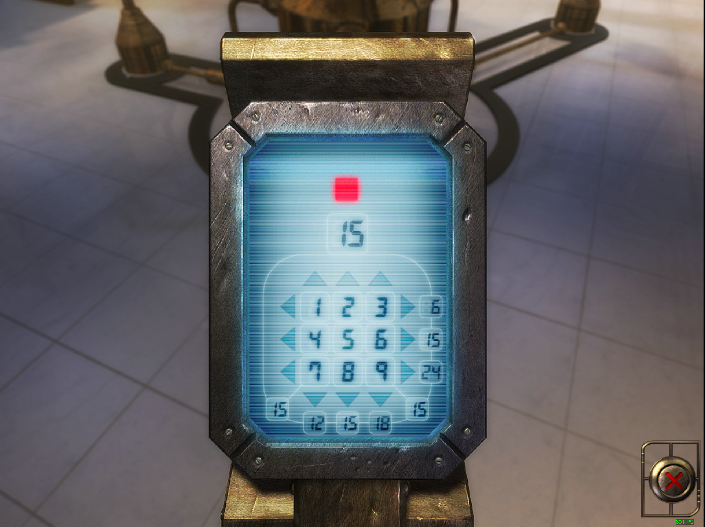

# Museum: Square Numbers

[← Previous: Museum - Currency](../currency_sudoku) | [Next: Museum - Tile Elimination →](../tile_elimination)

## Solution

Starts as a plain 3x3 grid of numbers 1-9. Each row and column can be cyclically shifted. Shift them so every row, column, and diagonal sums to 15 (a [magic square](https://en.wikipedia.org/wiki/Magic_square)):

```
Row 0  left
Row 2  right
Col 0  up
Col 2  down
```

Resulting code: **6821**


