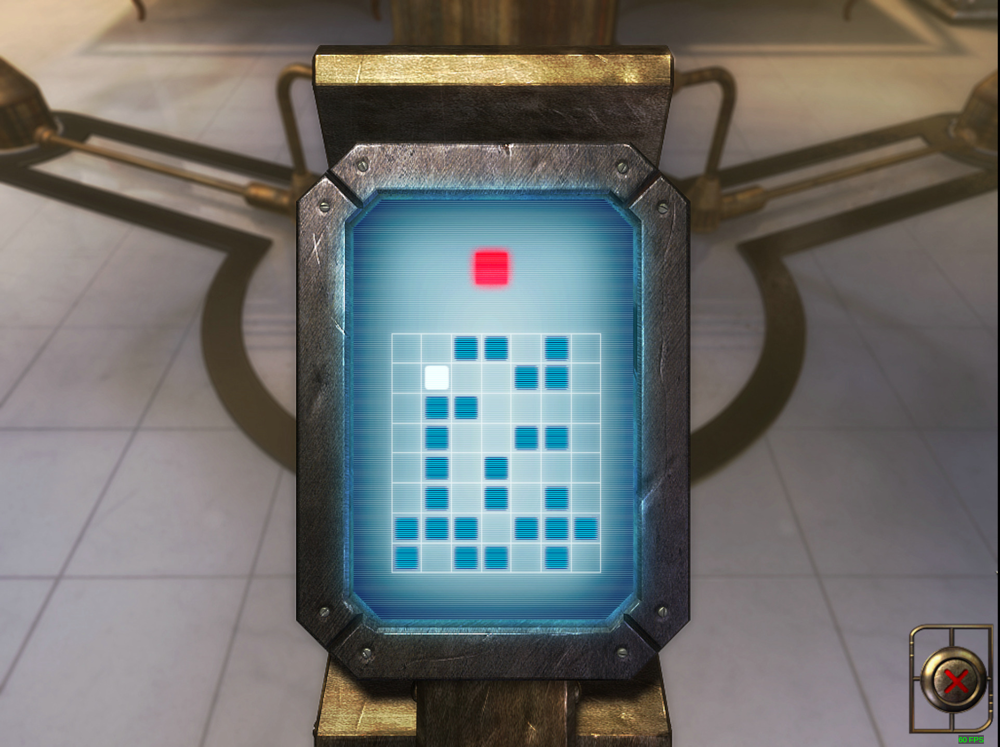

# Museum: Tile Elimination

[← Previous: Museum - Square Numbers](../museum_square_numbers) | [Next: Main Sitting Room - Cipher Disk →](../caesar_wheel)

## Solution

Starting on the marked tile, jump between white tiles (1 or 2 tiles away, in any of the 4 directions), eliminating the tile you leave, until none remain. Move order (distance + direction):

```
 D   R  2U   R
2R   D   L  2D
 R  2D  2D   U
 R  2L  2L   D
 R  2U   U  2L
 U  2D   D   L
 D
```


