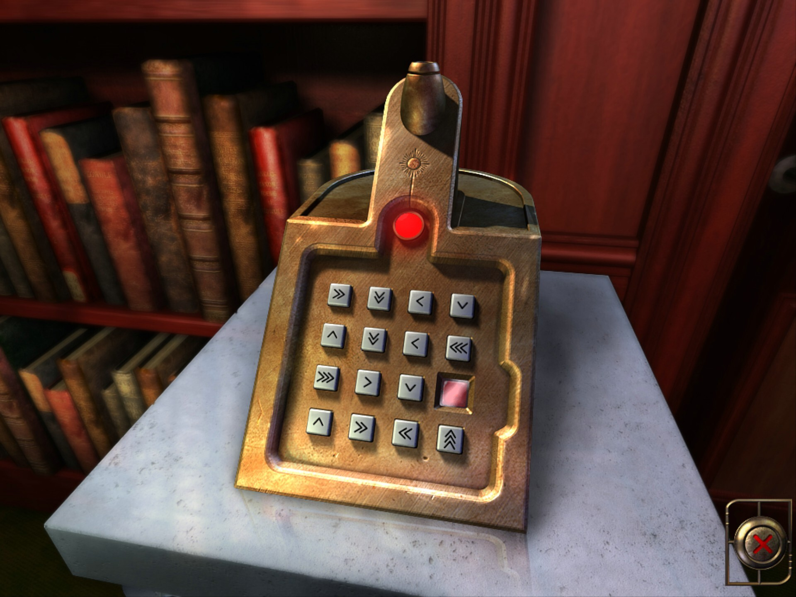

# Office: Arrow Keypad

[← Previous: Study - Worn Keypad](../study_keypad) | [Next: Workshop - Broken Keypad →](../workshop_keypad)

## Solution

Each tile on the 4x4 keypad shows an arrow and a repeat count telling you how many tiles to jump in that direction (the red button marked as the goal). Start at the one tile nothing else points to, then follow the chain of jumps -- the order you land on each (row, col) is the press order:

```
 0 (1, 2)
 1 (1, 1)
 2 (3, 1)
 3 (3, 3)
 4 (0, 3)
 5 (1, 3)
 6 (1, 0)
 7 (0, 0)
 8 (0, 2)
 9 (0, 1)
10 (2, 1)
11 (2, 2)
12 (3, 2)
13 (3, 0)
14 (2, 0)
15 (2, 3)
```


