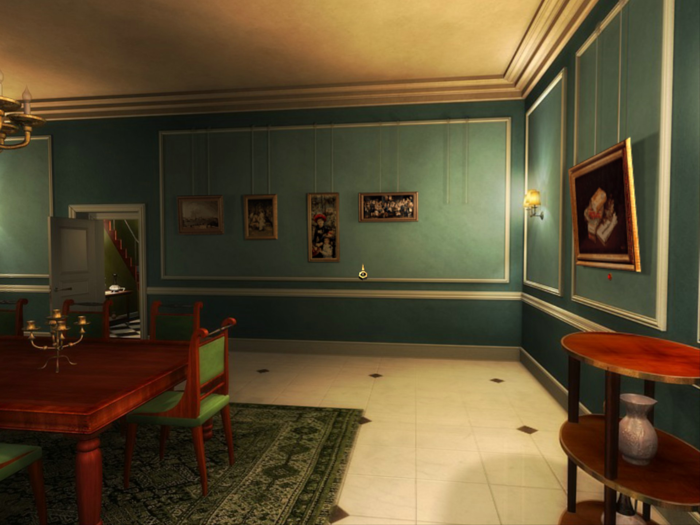

# Dining Room: Picture Swapping

[← Previous: Kitchen - Dumbwaiter](../kitchen_dumbwaiter) | [Next: West Corridor - Laser Door →](../colored_wires)

## Solution

Five picture slots (numbered 0-4, left to right) start as Square, Short, Tall, Long, Empty and must end as Tall, Long, Empty, Short, Square. You can only slide a picture into the currently empty slot. The goal is to replicate the picture arrangement seen in Sarah's photo. Move pictures into the empty slot in the following order (`source -> empty slot`):

```
1 -> 4
3 -> 1
4 -> 3
0 -> 4
2 -> 0
```


