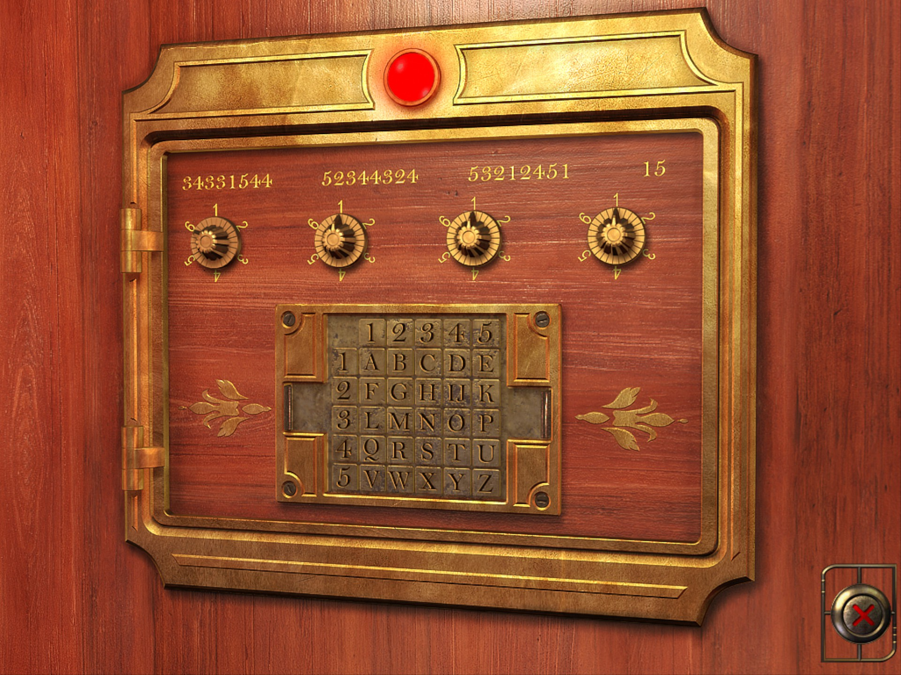

# Dressing Room: Polybius Square

[← Previous: Loft - Six Queens](../loft_queens) | [Next: Blue Bedroom - Mastermind Phone →](../mastermind_phone)

## Solution

Decode the pairs of digits using a 5x5 [Polybius square](https://en.wikipedia.org/wiki/Polybius_square) (rows/cols 1-5, letters a-e/f-k/l-p/q-u/v-z, with i/j sharing a cell). Each pair (row, col) gives one letter. The decoded message spells out digits as words ("onetwosixfive"), giving:

**Solution:** `1265`

