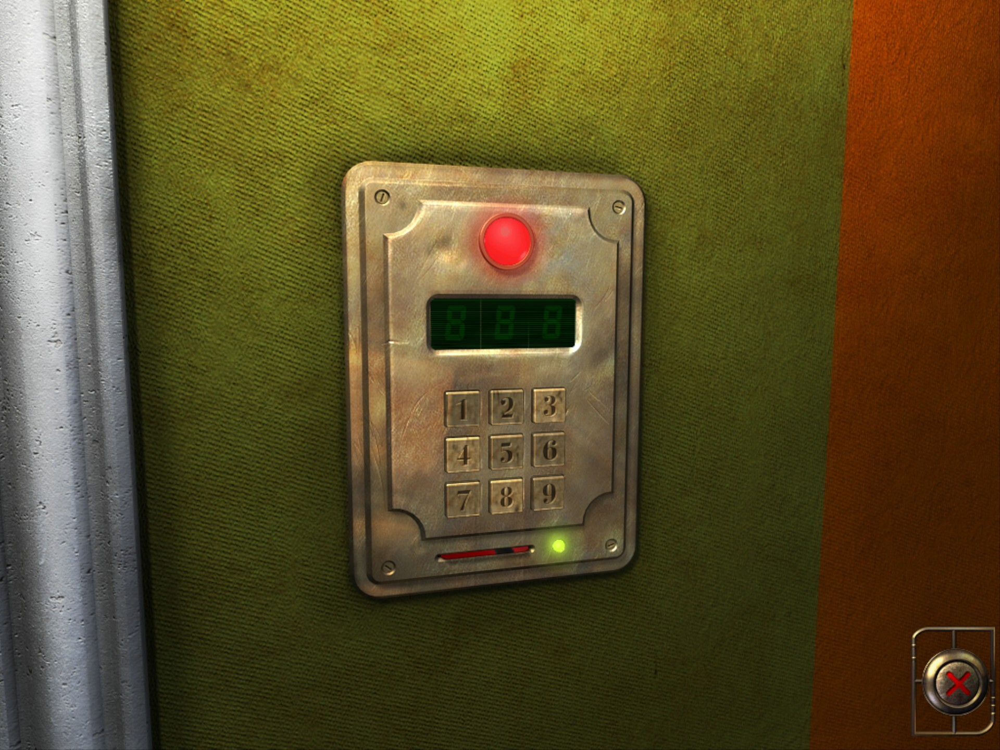

# Study: Worn Keypad

[← Previous: Study - Magnet Ball](../study_magnet_ball) | [Next: Office - Arrow Keypad →](../office_keypad)

## Solution

Wear patterns on the keypad narrow the code down to the digits 3, 4, and 8 in some order.

**Solution:** `834`

(If that hadn't matched, we'd try the other permutations: 348, 384, 438, 483, 843.)

