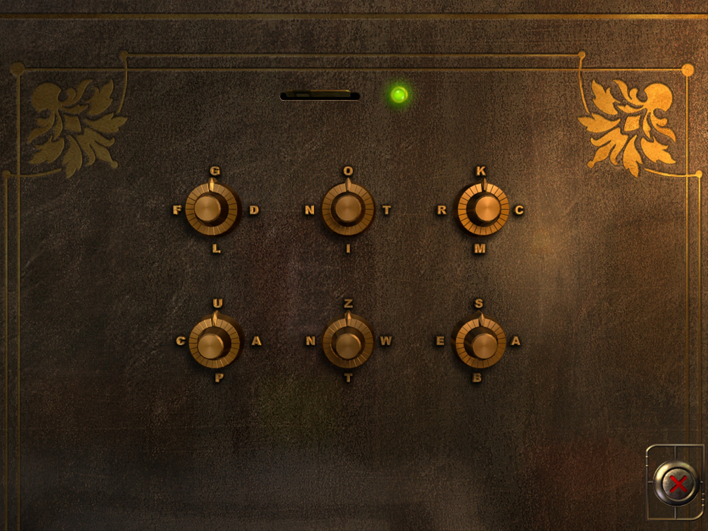

# Workshop: Walter Dials

[← Previous: Workshop - Laser Safe](../workshop_laser) | [Next: Basement - Electrical Panel →](../basement_knobs)

## Solution

There are 6 dials, numbered left-to-right/top-to-bottom as `0 1 2 / 3 4 5`. Each dial cycles through 4 letters, and the dials together must spell **WALTER**. Turn each dial the listed number of times:

```
Dial 0: 2x
Dial 1: 1x
Dial 2: 3x
Dial 3: 1x
Dial 4: 1x
Dial 5: 3x
```


