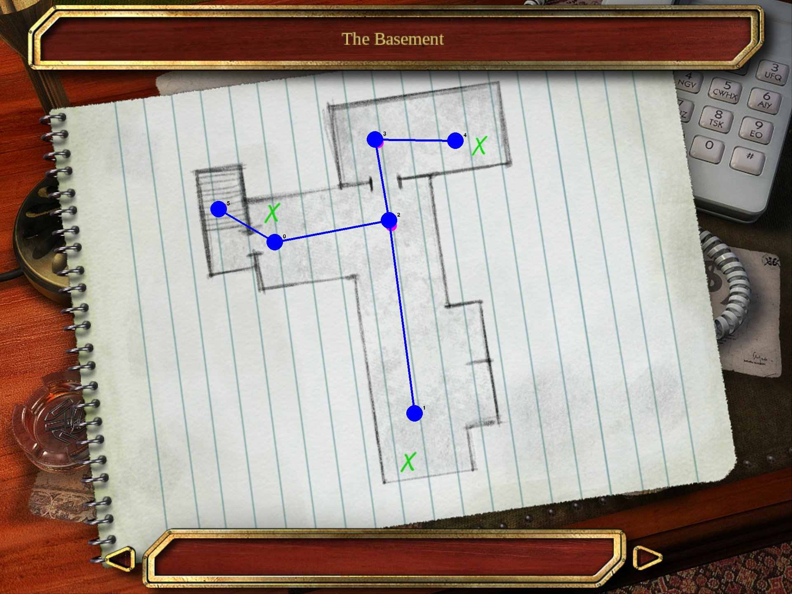
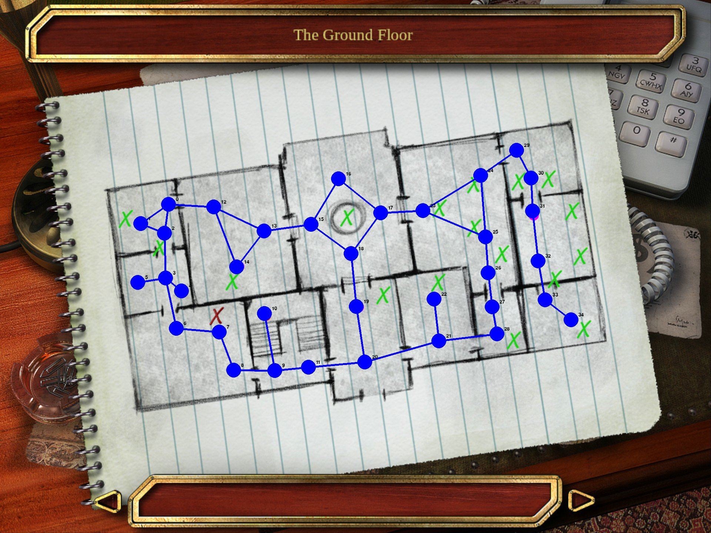
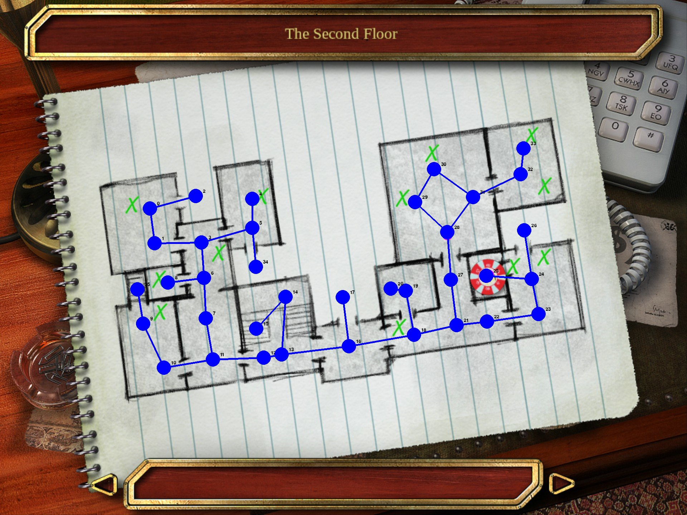
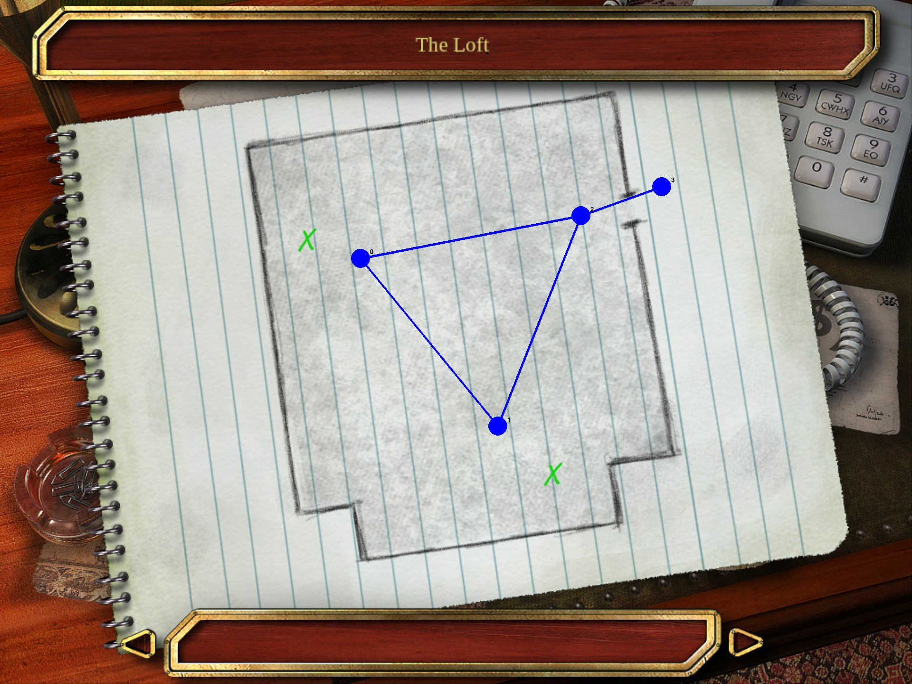

# Floor Plans

Tools and data for mapping the house's floor plans into a node graph (rooms/items as
nodes, accessible transitions as edges), and for working out item/objective dependencies
and routing order.

## Scripts

- [`node_editor.py`](node_editor.py) - Interactive pygame tool for placing/editing nodes
  and links on top of a floor plan image, saving them to a `*_nodes.json` file.
- [`floor_plan.py`](floor_plan.py) - Loads each floor's `*_nodes.json` into a combined
  graph (nodes prefixed per floor) for pathing across the whole house.
- [`route.py`](route.py) - Topologically sorts [`dependencies.py`](dependencies.py)'s
  objective graph to find a valid completion order.
- [`dependencies.py`](dependencies.py) - Hand-maintained `X requires Y` list of objectives
  and their prerequisites, parsed into `dependency_graph`.
- [`visualize.py`](visualize.py) - Renders [`dependencies.py`](dependencies.py)'s
  `dependency_graph` with networkx/graphviz.

## Data

- `floor_<basement|ground|second|loft>_nodes.json` - Node/link graph data for each floor,
  produced by `node_editor.py`.
- `floor_<basement|ground|second|loft>_nodes.jpg` - Floor plan images used as the editing
  backdrop for the node graphs.
- `floor_<basement|ground|second|loft>_nodes_output.jpg` - Rendered output showing the
  node graph overlaid on each floor plan.

## Images

### Basement

### Ground Floor

### Second Floor

### Loft

